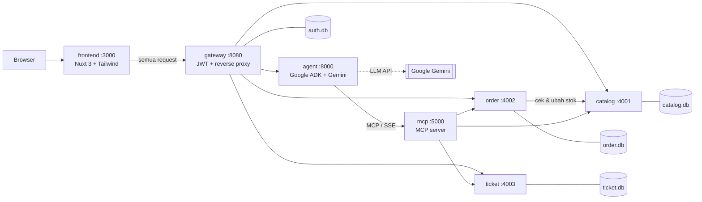
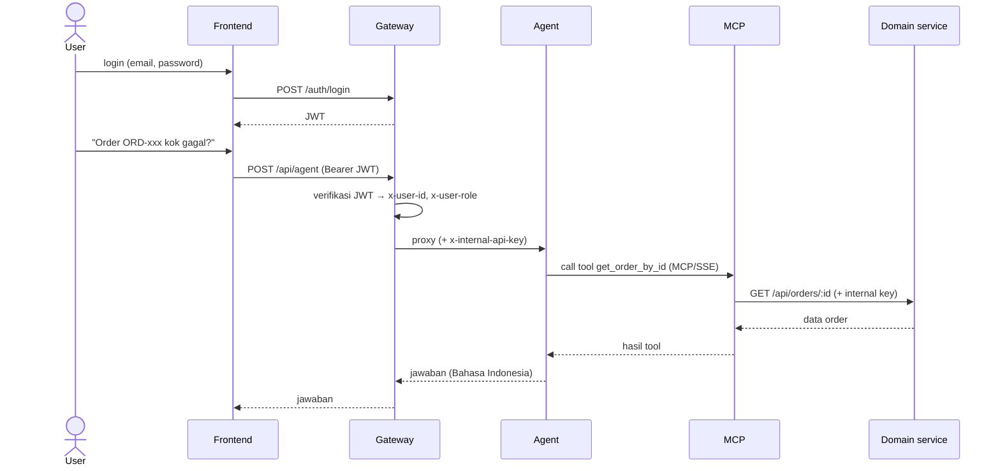
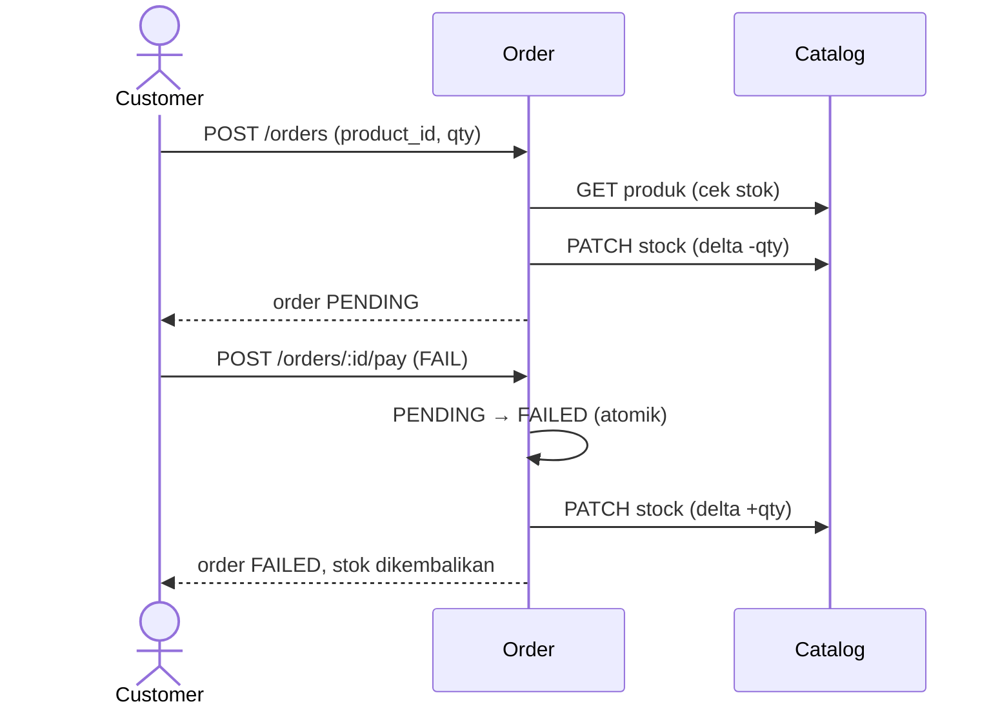
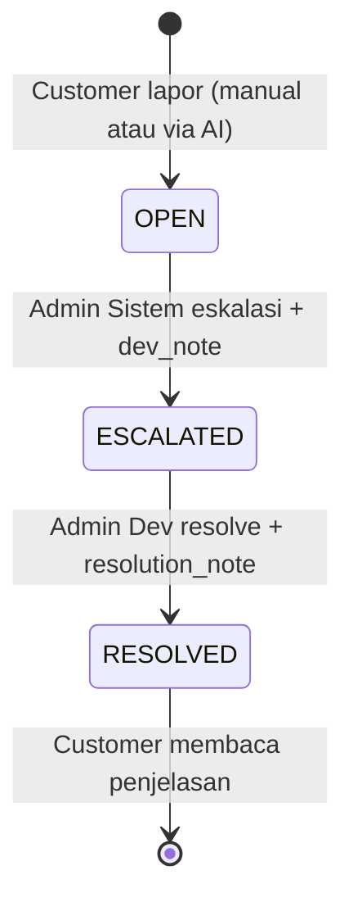

# PRD — TokoAI Microservices

| | |
|---|---|
| **Versi** | 1.0 (draft) |
| **Tanggal** | 2026-11-19 |
| **Status** | Draft untuk review |
| **Repo** | `toko-ai-microservices` |
| **Jenis proyek** | Proyek pembelajaran / demo (bukan produksi) |

---

## 1. Ringkasan

TokoAI adalah toko online berarsitektur **microservices** yang dilengkapi **asisten AI (Google Gemini via Google ADK)**. Asisten ini terhubung ke data toko melalui **MCP (Model Context Protocol)** sehingga pengguna dapat mengecek stok, memeriksa order, membuat tiket keluhan, mengeskalasi tiket, dan mengubah banner halaman depan langsung dari jendela chat.

Proyek ini punya dua tujuan:

1. **Produk**: menunjukkan bahwa operasional toko dan helpdesk dapat dipercepat dengan agen AI yang bertindak lintas-service dengan hak akses sesuai peran.
2. **Edukasi**: menjadi contoh referensi cara memecah aplikasi menjadi service kecil, menghubungkan AI agent ke data aplikasi lewat MCP, dan menjalankan semuanya dengan Docker Compose.

## 2. Latar Belakang & Masalah

| Masalah | Dampak |
|---|---|
| Admin harus membuka beberapa halaman/tool untuk satu pekerjaan (cek stok, cek order gagal, lihat tiket, eskalasi). | Waktu respons lambat, rawan terlewat. |
| Customer yang pembayarannya gagal tidak tahu harus ke mana, dan harus menjelaskan ulang masalahnya. | Pengalaman buruk, beban tiket meningkat. |
| Developer menerima laporan tanpa konteks order. | Investigasi lama. |
| Developer berlatih arsitektur microservices + AI agent tanpa contoh utuh yang mudah dijalankan. | Kurva belajar tinggi. |

## 3. Tujuan dan Non-Tujuan

### 3.1 Tujuan

- **G1** — AI dapat menjawab pertanyaan operasional dan melakukan aksi **lintas-service** dalam satu percakapan (contoh: cek order gagal → buat tiket).
- **G2** — Akses data dan aksi dibatasi **berdasarkan peran** (Customer, Admin Sistem, Admin Developer).
- **G3** — Alur helpdesk end-to-end: *order gagal → tiket → eskalasi → resolusi yang bisa dibaca customer*.
- **G4** — Seluruh sistem berjalan dengan **satu perintah** (`docker compose up -d --build`) dan juga bisa dijalankan manual untuk pengembangan.
- **G5** — Browser hanya berinteraksi dengan satu titik masuk (gateway).

### 3.2 Non-Tujuan

- Pembayaran sungguhan (pembayaran saat ini **simulasi**).
- Registrasi user, reset password, atau manajemen akun (hanya 4 akun demo).
- Skalabilitas produksi (multi-instance, HA, sharding data).
- Keranjang belanja multi-item (checkout saat ini 1 produk per order).
- Pengiriman/logistik, notifikasi email/WhatsApp, dan multi-bahasa (UI dan AI berbahasa Indonesia).

## 4. Persona & Peran

| Peran | Akun demo | Kebutuhan utama |
|---|---|---|
| **Customer** | `budi@toko.com`, `siti@toko.com` | Melihat produk, memesan, membayar (simulasi), menanyakan status order, melaporkan keluhan, membaca hasil penanganan tiket. |
| **Admin Sistem** | `admin@toko.com` | Mengubah banner, memantau stok menipis dan order gagal, meninjau tiket, mengeskalasi tiket teknis ke developer. |
| **Admin Developer** | `dev@toko.com` | Melihat antrean tiket `ESCALATED`, memeriksa detail order terkait, menyelesaikan tiket dengan catatan yang ramah customer. |

## 5. Kebutuhan Fungsional

### 5.1 Antarmuka (Frontend)

| ID | Kebutuhan | Peran |
|---|---|---|
| FR-01 | Halaman **Storefront** `/`: daftar produk, banner/hero dinamis, checkout, simulasi bayar, kirim laporan keluhan, melihat tiket sendiri beserta resolusinya. | Customer, pengunjung |
| FR-02 | Halaman **Admin** `/admin`: ubah banner, KPI stok menipis dan order gagal, daftar tiket, aksi eskalasi. | Admin Sistem |
| FR-03 | Halaman **Dev** `/dev`: antrean tiket `ESCALATED`, detail order terkait, aksi resolve. | Admin Developer |
| FR-04 | **AI Assistant widget** tersedia di setiap halaman. | Semua login |
| FR-05 | **Quick Role Switcher** untuk berganti akun demo tanpa mengetik password. | Demo |
| FR-06 | Akses halaman dibatasi per peran (`RoleGate`). | Semua |

### 5.2 Autentikasi (Gateway)

| ID | Kebutuhan |
|---|---|
| FR-10 | `POST /auth/login` memverifikasi email+password dan menerbitkan **JWT** (masa berlaku 24 jam) berisi `id, email, name, role`. |
| FR-11 | `GET /auth/demo-users` mengembalikan daftar akun demo. |
| FR-12 | Semua rute `/api/*` melewati `extractUserFromJwt`: token valid → inject `x-user-id` dan `x-user-role`; tanpa token → `GUEST`; token invalid → `401`. |

### 5.3 Katalog (`service-catalog`)

| ID | Kebutuhan | Hak akses |
|---|---|---|
| FR-20 | `GET /api/products` (opsional `?maxStock=` untuk stok menipis), `GET /api/products/:id`. | Publik |
| FR-21 | `POST /api/products` menambah produk. | Admin Sistem |
| FR-22 | `PATCH /api/products/:id/stock` dengan `delta`; menolak jika stok < 0. | Admin Sistem, `SYSTEM_INTERNAL` |
| FR-23 | `GET /api/landing` dan `PATCH /api/landing` (hero title, subtitle, promo banner). | Publik / Admin Sistem |

### 5.4 Order (`service-order`)

| ID | Kebutuhan |
|---|---|
| FR-30 | `POST /api/orders` (Customer): validasi → cek produk ke catalog → **potong stok (reservasi)** → simpan order berstatus `PENDING`. |
| FR-31 | `POST /api/orders/:id/pay` (Customer pemilik order): simulasi `SUCCESS`/`FAIL`. Hanya order `PENDING` yang boleh dibayar (transisi atomik, `409` jika bukan). |
| FR-32 | Jika pembayaran **FAILED**, stok **dikembalikan** ke catalog; bila pengembalian gagal, transisi dibatalkan agar konsisten. |
| FR-33 | `GET /api/orders` (+ `?status=`): Customer hanya melihat miliknya; Admin/Dev melihat semua. |
| FR-34 | `GET /api/orders/:id` detail order. |

Siklus status order: `PENDING → PAID` atau `PENDING → FAILED` (stok dikembalikan).

### 5.5 Tiket (`service-ticket`)

| ID | Kebutuhan | Hak akses |
|---|---|---|
| FR-40 | `POST /api/tickets` membuat tiket (`PAYMENT_ISSUE`, `BUG_UI`, `GENERAL`), status awal `OPEN`. | Customer |
| FR-41 | `GET /api/tickets` (+ filter `status`, `category`): Customer hanya melihat miliknya dan **tanpa `dev_note`** (catatan internal). | Semua login |
| FR-42 | `PATCH /api/tickets/:id/escalate` → `ESCALATED` + `dev_note`. | Admin Sistem |
| FR-43 | `PATCH /api/tickets/:id/resolve` → `RESOLVED` + `resolution_note` (ditampilkan ke customer) + `resolved_at`. | Admin Developer |

Siklus status tiket: `OPEN → ESCALATED → RESOLVED`.

### 5.6 AI Agent & MCP

| ID | Kebutuhan |
|---|---|
| FR-50 | `service-agent` menjalankan **LlmAgent** (Google ADK, model Gemini Flash-Lite) dengan instruksi RBAC dan gaya komunikasi Bahasa Indonesia ringkas. |
| FR-51 | Agent mengakses data **hanya** lewat MCP tools di `service-mcp` (transport SSE); agent tidak menyentuh database. |
| FR-52 | `service-mcp` menyediakan 9 tools: |

| Tool | Domain | Peran yang dimaksud |
|---|---|---|
| `get_all_products` | Catalog | Semua |
| `get_low_stock_products` | Catalog | Admin Sistem |
| `update_landing_banner` | Catalog | Admin Sistem |
| `get_order_by_id` | Order | Customer, Admin |
| `get_orders_by_status` | Order | Admin Sistem |
| `get_tickets` | Ticket | Admin Sistem, Admin Dev |
| `create_support_ticket` | Ticket | Customer |
| `escalate_ticket_to_dev` | Ticket | Admin Sistem |
| `resolve_dev_ticket` | Ticket | Admin Developer |

| ID | Kebutuhan |
|---|---|
| FR-53 | Resolution note yang ditulis AI harus sopan, non-teknis, berbahasa Indonesia, menyebut penyebab dan langkah selanjutnya. |
| FR-54 | Untuk aksi lintas-service, AI merangkum hasil secara terstruktur. |

## 6. High-Level Architecture

### 6.1 Diagram Komponen



### 6.2 Daftar Service

| Service | Port | Tanggung jawab | Teknologi | Data |
|---|---|---|---|---|
| `service-frontend` | 3000 | UI storefront, admin, dev; widget AI | Nuxt 3, Vue, Tailwind | — |
| `service-gateway` | 8080 | Login/JWT, injeksi identitas, reverse proxy, CORS | Express, TypeScript, `http-proxy-middleware` | `auth.db` |
| `service-catalog` | 4001 | Produk, stok, banner landing | Express, TypeScript, SQLite | `catalog.db` |
| `service-order` | 4002 | Order, simulasi pembayaran, reservasi/pengembalian stok | Express, TypeScript, SQLite | `order.db` |
| `service-ticket` | 4003 | Tiket helpdesk dan alur eskalasi | Express, TypeScript, SQLite | `ticket.db` |
| `service-mcp` | 5000 | Mengekspos kapabilitas toko sebagai MCP tools | `@modelcontextprotocol/sdk`, zod | — |
| `service-agent` | 8000 | Orkestrasi LLM, instruksi RBAC | `@google/adk`, Gemini | — |

### 6.3 Prinsip Arsitektur

1. **Satu pintu masuk** — browser hanya berbicara dengan gateway; service lain tidak diekspos untuk klien.
2. **Database per service** — tidak ada tabel yang dibagi; data service lain diakses lewat API.
3. **AI tidak menyentuh database** — AI → MCP tools → API domain service.
4. **Identitas dua lapis** — JWT di tepi (gateway); antar-service memakai `x-internal-api-key` (secret bersama) plus header `x-user-id` / `x-user-role`.
5. **Konfigurasi lewat environment** — URL antar-service di-override oleh Docker Compose dengan nama service di jaringan Docker.

### 6.4 Alur Utama

**A. Login dan chat dengan AI**



**B. Checkout dan pembayaran gagal**



**C. Alur helpdesk end-to-end**



### 6.5 Deployment

- **Docker Compose** (`name: tokoai`), satu container per service.
- **Urutan start** diatur `depends_on` + healthcheck: `catalog` & `ticket` → `order` → `mcp` → `agent` → `gateway` → `frontend`.
- Port service internal di-bind ke `127.0.0.1`; hanya `gateway` (8080) dan `frontend` (3000) terbuka.
- SQLite disimpan di volume host `./service-*/data` (bukan di dalam container).
- Mode manual (`npm run dev`) tersedia untuk hot reload; tidak boleh dijalankan bersamaan dengan Docker (bentrok port).

### 6.6 Konfigurasi & Secret

| Variabel | Lokasi | Keterangan |
|---|---|---|
| `GEMINI_API_KEY` | `service-agent/.env` | **Wajib** diisi pengguna |
| `JWT_SECRET` | `service-gateway/.env` | Penanda tangan JWT |
| `INTERNAL_API_KEY` | catalog, order, ticket, mcp, gateway | Harus identik di semua service |
| `*_SERVICE_URL`, `MCP_SSE_URL` | masing-masing service | Di-override Compose saat memakai Docker |

## 7. Kebutuhan Non-Fungsional

| Kategori | Kebutuhan |
|---|---|
| **Keamanan** | RBAC diterapkan di service domain (`requireRole`); secret tidak di-commit (`.env` di `.gitignore`); `dev_note` tidak bocor ke customer. |
| **Keandalan** | Healthcheck `/health` per service; `restart: unless-stopped`; pengembalian stok bersifat kompensasi dan konsisten. |
| **Kemudahan setup** | Hanya `GEMINI_API_KEY` yang wajib diisi; data contoh dibuat otomatis saat start pertama; reset data dengan menghapus file `.db`. |
| **Observability** | Saat ini log stdout per service (`docker compose logs -f <svc>`). |
| **Portabilitas** | Windows/macOS/Linux; Node.js ≥ 22 untuk mode manual. |
| **Kinerja** | Tidak ada target formal; target informal: respons CRUD < 300 ms, respons AI bergantung pada latensi Gemini. |

## 8. Risiko & Isu Terbuka

Temuan berikut berasal dari tinjauan kode saat ini. Untuk demo/pembelajaran dapat diterima, tetapi **harus diperbaiki sebelum dipakai di luar lingkungan lokal**.

| # | Risiko | Lokasi | Dampak | Usulan mitigasi |
|---|---|---|---|---|
| R1 | **Otorisasi AI bergantung pada parameter `actor_role` yang diisi LLM.** Peran tidak diambil dari JWT. | `service-mcp/src/tools/registerTools.ts` | Prompt injection / halusinasi dapat meningkatkan hak akses (mis. Customer mengeskalasi tiket). | Teruskan `x-user-id`/`x-user-role` dari JWT sampai ke MCP (per-session context); hapus `actor_role` dari skema tool; validasi ulang di domain service. |
| R2 | `create_support_ticket` memakai role `CUSTOMER` tetap dan `user_id` dari parameter (default `USR-01`). | `registerTools.ts` | Tiket bisa dibuat atas nama user lain. | Ambil `user_id` dari identitas terautentikasi, bukan dari LLM. |
| R3 | `get_orders_by_status` dan `get_tickets` selalu memakai role `ADMIN_SISTEM`. | `registerTools.ts` | Customer yang bertanya ke AI dapat membaca data order/tiket pengguna lain. | Gunakan role/identitas pemanggil asli; batasi tool per peran. |
| R4 | `GET /api/orders/:id` tidak memeriksa kepemilikan order. | `service-order/src/routes/order.routes.ts` | Customer bisa membaca order milik orang lain bila tahu ID-nya (IDOR). | Terapkan pengecekan `user_id` untuk Customer. |
| R5 | Password dibandingkan sebagai **plaintext** di query SQL. | `service-gateway/src/index.ts` | Kebocoran `auth.db` membuka semua password. | Hash dengan bcrypt/argon2. |
| R6 | Order ID/Ticket ID dibuat dengan `Math.random()` pada rentang kecil. | order & ticket routes | Kemungkinan tabrakan ID. | Gunakan sequence/UUID. |
| R7 | Potong stok lalu simpan order tidak transaksional lintas service. | `service-order` | Stok terpotong tetapi order gagal tersimpan (inkonsistensi). | Pola saga/kompensasi atau idempotency key. |
| R8 | Satu secret bersama `INTERNAL_API_KEY` dan CORS terbuka (`cors()`). | gateway & semua service | Kebocoran satu key membuka semua service. | Per-service credential/mTLS; batasi origin CORS. |
| R9 | SQLite per service tidak mendukung multi-instance. | semua service data | Tidak bisa diskalakan horizontal. | Migrasi ke PostgreSQL bila keluar dari skala demo. |
| R10 | Ketergantungan pada layanan LLM eksternal (kuota/latensi/biaya). | `service-agent` | AI tidak tersedia saat kuota habis/API down. | Timeout, pesan fallback di UI, caching/limit. |

**Pertanyaan terbuka**

1. Apakah proyek tetap dibatasi sebagai demo edukasi, atau akan dikembangkan menuju produksi? (menentukan prioritas R1–R9)
2. Apakah customer boleh bertanya soal produk/stok lewat AI, atau hanya order dan tiket miliknya?
3. Perlukah audit log untuk aksi yang dilakukan AI (siapa, tool apa, parameter apa)?
4. Apakah perlu konfirmasi pengguna (human-in-the-loop) sebelum AI menjalankan aksi yang mengubah data (eskalasi, resolve, ubah banner)?

## 9. Metrik Keberhasilan

| Metrik | Target |
|---|---|
| Setup dari clone sampai berjalan | ≤ 15 menit, hanya mengisi `GEMINI_API_KEY` |
| Semua service `healthy` setelah `docker compose up` | 7/7 |
| Skenario demo end-to-end (order gagal → tiket → eskalasi → resolve) berhasil tanpa error | 100% |
| Tool call AI yang menghasilkan hasil benar pada skenario uji | ≥ 90% |
| Percobaan aksi di luar peran yang ditolak sistem | 100% (setelah R1–R4 diperbaiki) |

## 10. Rencana Rilis

| Fase | Cakupan | Status |
|---|---|---|
| **M1 — MVP demo** | 7 service, 3 halaman, 9 MCP tools, Docker Compose, akun demo | Tercapai (kode saat ini) |
| **M2 — Hardening keamanan** | R1–R5: propagasi identitas ke MCP, perbaikan IDOR, hash password | Direncanakan |
| **M3 — Ketahanan data** | R6–R7: ID unik, saga/idempotensi stok-order | Direncanakan |
| **M4 — Observability & uji** | Log terstruktur, audit aksi AI, tes otomatis (unit + e2e skenario helpdesk) | Direncanakan |
| **M5 — Opsional** | Keranjang multi-item, PostgreSQL, notifikasi, evaluasi kualitas AI | Eksplorasi |

## 11. Lampiran

### 11.1 Struktur Repo

```
toko-ai-microservices/
├── docker-compose.yml
├── service-frontend/   # Nuxt 3 + Tailwind
├── service-gateway/    # login JWT & proxy
├── service-catalog/    # produk & banner
├── service-order/      # pesanan & pembayaran
├── service-ticket/     # tiket helpdesk
├── service-mcp/        # MCP server (tools untuk AI)
└── service-agent/      # AI agent (Google ADK + Gemini)
```

### 11.2 Glosarium

| Istilah | Arti |
|---|---|
| **MCP** | Model Context Protocol — standar agar AI memanggil tools/data eksternal |
| **ADK** | Agent Development Kit dari Google |
| **RBAC** | Role-Based Access Control |
| **Reservasi stok** | Stok dipotong saat checkout dan dikembalikan jika pembayaran gagal |
| **`SYSTEM_INTERNAL`** | Peran internal yang dipakai service-order untuk mengubah stok di catalog |
